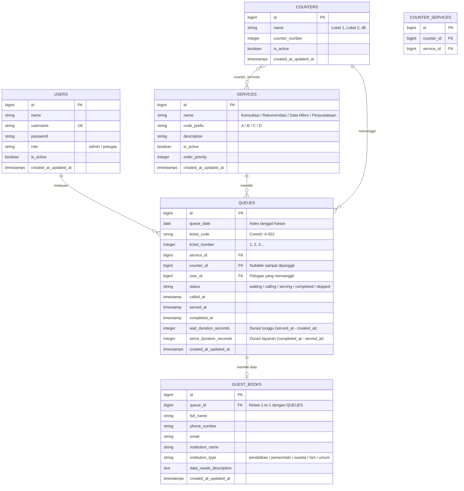
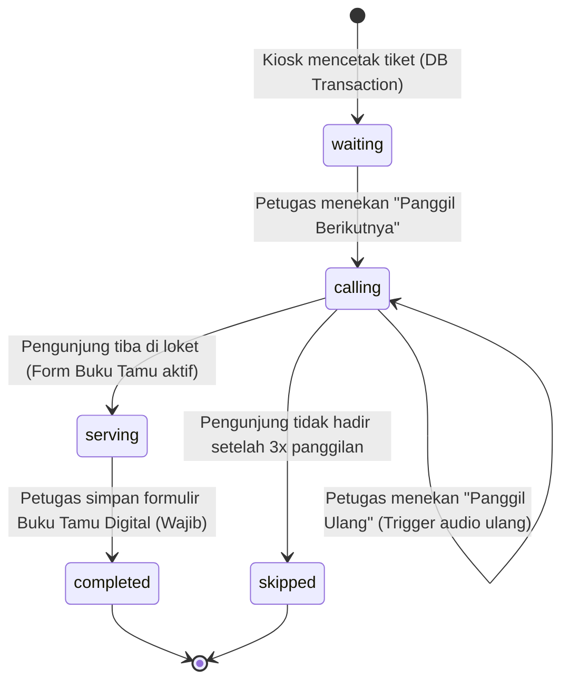

# Dokumen Desain Teknis (Spesifikasi Sistem)
## Sistem Informasi Antrean Berbasis Web & Mini Dashboard Rekapitulasi Pengunjung PST BPS (Fokus Backend)

- **Tanggal Dokumen**: 18 November 2026
- **Status**: Disetujui (Approved)
- **Pelaksana Teknis**: Pandu Dwi Ashidiqi (Backend & Hardware Integrator)
- **Instansi Mitra**: Pelayanan Statistik Terpadu (PST) Badan Pusat Statistik (BPS)
- **Basis Referensi**: Proposal Capstone Project Universitas Siliwangi 2026

---

## 1. Ringkasan Eksekutif & Tujuan Proyek

Dokumen ini mendefinisikan spesifikasi arsitektur teknis dan rancangan backend untuk Sistem Informasi Antrean Berbasis Web pada Pelayanan Statistik Terpadu (PST) Badan Pusat Statistik. Sistem ini memodernisasi alur antrean fisik, pencatatan buku tamu secara digital, dan penyediaan instrumen evaluasi manajerial berbasis data bagi pimpinan BPS.

### Ruang Lingkup Layanan PST BPS:
1. **Layanan Konsultasi Statistik** (Kode Prefix `A`)
2. **Layanan Rekomendasi Kegiatan Statistik** (Kode Prefix `B`)
3. **Layanan Permintaan Data Mikro & Publikasi** (Kode Prefix `C`)
4. **Layanan Perpustakaan Statistik** (Kode Prefix `D`)

---

## 2. Keputusan Arsitektur & Tumpukan Teknologi (*Technology Stack*)

1. **Pola Arsitektur**:
   - **Laravel Monolith (Blade + Tailwind CSS + Alpine.js/Vanilla JS)** dalam satu repositori kerja.
   - Menyediakan endpoint API/JSON internal untuk kebutuhan permintaan asynchronous (AJAX) dan pengaliran event dari antarmuka Kiosk, Layar Display TV, dan Meja Loket.
2. **Framework & Runtimes**:
   - Bahasa Pemrograman: PHP 8.2+ (diuji pada PHP 8.5 lingkungan Distrobox).
   - Web Framework: Laravel 11/12 dengan Eloquent ORM.
   - Basis Data:
     - *Development*: SQLite (lokal tanpa server daemon).
     - *Deployment*: MySQL / MariaDB (jaringan lokal LAN kantor BPS melalui konfigurasi `.env`).
3. **Mekanisme Realtime**:
   - **Server-Sent Events (SSE)** via endpoint `/display/stream` dengan fallback HTTP polling berkala (2-3 detik). Sangat stabil dan ringan pada jaringan lokal tanpa dependensi daemon WebSocket pihak ketiga.
4. **Integrasi Perangkat Keras (Thermal Printer & Audio)**:
   - **Cetak Tiket Kiosk**: Browser Silent Printing via `window.print()` dengan konfigurasi CSS `@media print` dan flag peramban `--kiosk-printing`. Dilengkapi *Virtual Ticket Preview & Mock Print* untuk fase pengembangan.
   - **Pemanggil Suara (Sound Announcer)**: Pustaka audio lokal WAV/MP3 offline diputar berurutan (*gapless audio queue*) di peramban Layar Display TV.
5. **Autentikasi & Otorisasi**:
   - Autentikasi sesi Laravel untuk Petugas Loket (`petugas`) dan Administrator (`admin`).
   - Rute `/kiosk` dan `/display` bersifat publik (*open kiosk mode*) agar operasional anjungan dan TV ruang tunggu tidak terhambat sesi kadaluarsa.

---

## 3. Skema Basis Data & Model Relasional

### 3.1 Diagram Hubungan Entitas (*Entity Relationship Diagram*)

### 3.2 Aturan Integritas Data & Indeks
- **Composite Index**: `(queue_date, service_id, ticket_number)` pada tabel `queues` untuk menjamin kueri pencarian dan pengurutan nomor antrean berjalan optimal.
- **Pessimistic Locking**: Pembuatan tiket baru di Kiosk dan pemanggilan antrean berikutnya di Loket menerapkan `DB::transaction()` dan `lockForUpdate()` guna mencegah *race condition* dan nomor duplikat.
- **Kalkulasi Metrik**: Kolom `wait_duration_seconds` dan `serve_duration_seconds` dihitung otomatis saat status antrean berubah, menyediakan dasar pelaporan rata-rata waktu layanan bagi pimpinan BPS.

---

## 4. Alur Kerja Logika Bisnis (*Queue Lifecycle State Machine*)

### Spesifikasi Transisi Status:
1. `waiting`: Tiket diterbitkan dari anjungan Kiosk, nomor antrean tersimpan dengan penomoran berurutan per layanan pada hari berjalan.
2. `calling`: Petugas loket menarik nomor antrean berikutnya yang berstatus `waiting` sesuai kategori layanan yang ditugaskan. Event SSE dikirim ke layar Display TV.
3. `serving`: Pengunjung duduk di meja pelayanan. Waktu `served_at` dicatat, formulir input Buku Tamu Digital terbuka di layar petugas.
4. `completed`: Petugas menuntaskan pelayanan dan menekan tombol simpan buku tamu. Sistem memvalidasi seluruh field data tamu, menyimpan data ke tabel `guest_books`, mencatat `completed_at`, dan menutup tiket.
5. `skipped`: Jika pengunjung tidak datang setelah dipanggil berulang kali, antrean ditutup dengan status `skipped` tanpa mewajibkan pengisian buku tamu.

---

## 5. Pemetaan Rute Antarmuka & API (*Route Map*)

| Jalur Rute | Method | Controller & Aksi | Hak Akses | Keterangan |
| :--- | :---: | :--- | :---: | :--- |
| `/kiosk` | `GET` | `KioskController@index` | Publik | Tampilan layar sentuh anjungan mandiri |
| `/kiosk/ticket` | `POST` | `KioskController@storeTicket` | Publik | Penerbitan tiket baru (JSON response) |
| `/display` | `GET` | `DisplayController@index` | Publik | Layar monitor TV ruang tunggu BPS |
| `/display/stream` | `GET` | `DisplayController@streamUpdates` | Publik | Server-Sent Events (SSE) `text/event-stream` |
| `/login` | `GET`/`POST` | `AuthController@login` | Guest | Autentikasi petugas dan admin |
| `/loket` | `GET` | `CounterController@index` | `auth (petugas)` | Meja kerja pemanggilan dan buku tamu |
| `/loket/call-next` | `POST` | `CounterController@callNext` | `auth (petugas)` | Ambil dan panggil nomor antrean berikutnya |
| `/loket/recall` | `POST` | `CounterController@recall` | `auth (petugas)` | Panggil ulang antrean aktif |
| `/loket/start-serve`| `POST` | `CounterController@startServing`| `auth (petugas)` | Tandai pengunjung hadir, buka buku tamu |
| `/loket/complete` | `POST` | `CounterController@complete` | `auth (petugas)` | Validasi buku tamu & selesaikan antrean |
| `/loket/skip` | `POST` | `CounterController@skip` | `auth (petugas)` | Lewati nomor antrean yang tidak hadir |
| `/admin/dashboard` | `GET` | `DashboardController@index` | `auth (admin)` | Mini dashboard rekapitulasi BPS |
| `/admin/reports` | `GET` | `ReportController@index` | `auth (admin)` | Filter data kunjungan berkala |
| `/admin/reports/export` | `GET`| `ReportController@export` | `auth (admin)` | Ekspor spreadsheet dan dokumen PDF |

---

## 6. Integrasi Perangkat Keras & Mekanisme Emulasi Pengujian

### 6.1 Thermal Printer Kiosk
- **Mode Produksi (Hardware Terpasang)**:
  Peramban Kiosk dijalankan dengan flag `--kiosk --kiosk-printing`. Perintah `window.print()` mencetak struk tiket langsung ke thermal printer USB tanpa popup.
- **Mode Pengembangan (`KIOSK_MOCK_PRINT=true`)**:
  Peramban memunculkan kartu pratinjau tiket virtual (*Virtual Ticket Preview*) di layar selama 3 detik, menampilkan tata letak struk, kode tiket, tanggal, dan sisa antrean, serta mencatat data ke log backend.

### 6.2 Sound Announcer di Display TV
- Berkas audio lokal disimpan di `public/audio/announcer/`.
- Algoritma *FIFO Audio Queue* di sisi klien mencegah benturan pemutaran audio jika dua loket memanggil dalam waktu bersamaan.
- Disediakan tombol pengujian audio (*Audio Test Panel*) pada halaman display untuk memverifikasi seluruh kombinasi suara angka dan huruf tanpa harus memicu antrean riil.

---

## 7. Mini Dashboard & Ekspor Pelaporan Manajerial BPS

1. **KPI Cards Dashboard**:
   - Total Kunjungan Hari Ini & Komparasi Historis.
   - Antrean Menunggu vs Sedang Dilayani vs Selesai.
   - Rata-rata Durasi Menunggu (*Wait Time*) & Durasi Pelayanan (*Service Time*).
2. **Visualisasi Data**:
   - Grafik Tren Kunjungan Harian/Bulanan (Chart.js / SVG).
   - Diagram Lingkaran Distribusi Layanan PST (Konsultasi, Rekomendasi, Data Mikro, Perpustakaan).
   - Diagram Batang Proporsi Kategori Pemohon (Pendidikan, Pemerintah, Swasta, LSM, Umum).
3. **Ekspor Laporan**:
   - **Spreadsheet Excel / CSV**: Berisi rekaman mentah buku tamu terverifikasi untuk pengolahan statistik lanjutan.
   - **Dokumen Ringkasan PDF**: Dokumen resmi dengan kop BPS, tabel rekapitulasi bulanan, dan kolom tanda tangan pimpinan.

---

## 8. Rencana Pengujian Otomatis (*Automated Test Suite*)

- `Feature/QueueNumberingTest.php`: Memverifikasi urutan penomoran harian (A-001, A-002) dan reset harian otomatis saat tanggal berganti.
- `Feature/ConcurrencyQueueTest.php`: Simulasi *concurrency* pemanggilan antrean untuk memastikan tidak ada nomor ganda.
- `Feature/GuestBookValidationTest.php`: Memverifikasi bahwa antrean tidak dapat berstatus `completed` jika data buku tamu belum diisi lengkap.
- `Feature/SseStreamTest.php`: Memverifikasi payload event `queue-called` pada koneksi SSE.
